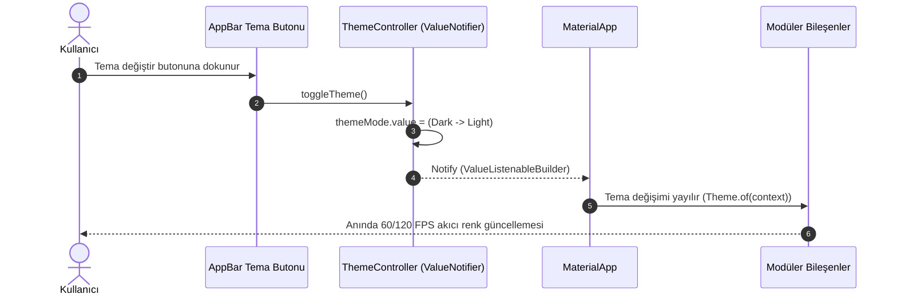

# Reaktif Durum ve Veri Akışı Referans Kılavuzu (State Flow Reference)

Bu doküman, **Susadım** fitness ve su takip uygulamasında ve `flutter-feature-scaffold` yeteneğinde uygulanan reaktif durum mimarisinin (`ValueNotifier`), veri akışının, geri alma (Undo) mekanizmasının ve tema yönetiminin teknik referans rehberidir.

Projedeki tüm modüller [project.md](file:///Users/d1-23/Desktop/19_ekim_ders_3/project.md) ve [.agents/skills/SKILL.md](file:///Users/d1-23/Desktop/19_ekim_ders_3/.agents/skills/SKILL.md) standartlarına tavizsiz uymak zorundadır.

---

## 1. Temel Mimari Prensipler ve Kırmızı Çizgiler

> [!IMPORTANT]
> **Kırmızı Çizgi 1 (Ağır `setState` Yasağı):** Sayfa düzeyinde büyük ağaçları baştan sona yeniden çizen `setState` kullanımı kesinlikle yasaktır. Sadece yerel geçici arayüz durumları (örneğin ufak bir butonun animasyon kontrolü) için `StatefulWidget` kabul edilir.

> [!WARNING]
> **Kırmızı Çizgi 2 (Harici Ağır Paket Yasağı):** Mimari kurula danışılmadan ve açık onay alınmadan projeye Bloc, Riverpod, MobX veya Redux gibi harici ağır state yönetim paketleri **eklenmeyecektir**. Dart ve Flutter'ın yerel çekirdek API'si olan `ValueNotifier` ve `ValueListenableBuilder` esastır.

> [!TIP]
> **UI ve Performans Standardı:**
> - Statik tüm widget tanımlarında `const` zorunludur.
> - Tek bir `build()` metodu asla 40 satırı geçemez. Aşan yapılar bağımsız özel widget bileşenlerine parçalanmalıdır.
> - Renkler ve tipografiler doğrudan kod içine gömülmez; tema ve `AppColors` tanımları üzerinden çağrılır.

---

## 2. Reaktif Durum Akış Şeması (End-to-End Reactive Flow)

Sistemdeki veri akışı **tek yönlüdür (Unidirectional Data Flow)**. Kullanıcı etkileşimi doğrudan kontrolcü metodunu tetikler; kontrolcü durumu atomik olarak günceller ve yalnızca ilgili `ValueListenableBuilder` düğümü yeniden çizilir.

```mermaid
graph TD
    subgraph UI_Layer["Arayüz Katmanı (View & Widgets)"]
        UI_Action["Kullanıcı Aksiyonu (Örn: +250 ml Butonu)"]
        VLB["ValueListenableBuilder<int>"]
        ReRender["Hedeflenen Parçacık Widget Render (<40 satır)"]
    end

    subgraph Controller_Layer["İş Mantığı Katmanı (Controller)"]
        CtrlMethod["controller.addWater(amount)"]
        StateUpdate["currentWater.value += amount"]
        HistoryUpdate["history.value = [...history.value, entry]"]
        BadgeCheck["badgeController.checkWaterBadges(...)"]
    end

    subgraph Model_Layer["Veri Modeli (Immutable)"]
        NewModel["WaterEntryModel (id, amountMl, timestamp, label)"]
    end

    UI_Action -->|1. Tetikler| CtrlMethod
    CtrlMethod -->|2. Yeni Model Üretir| NewModel
    NewModel -->|3. Yığına Ekler| HistoryUpdate
    CtrlMethod -->|4. Değeri Günceller| StateUpdate
    StateUpdate -->|5. Bildirir (Notify)| VLB
    VLB -->|6. Scoped Render| ReRender
    CtrlMethod -->|7. Hedef Aşımı Kontrolü| BadgeCheck
```

---

## 3. Katman Sorumlulukları ve Dosya Dağılımı

Her bir özellik (feature) kendi izole dizininde 4 ana parçadan oluşur:

| Katman | Dosya Kalıbı | Sorumluluk | İzin Verilenler | Yasaklananlar |
| :--- | :--- | :--- | :--- | :--- |
| **Model** | `*_model.dart` | Değişmez (Immutable) veri tutucu | `final` alanlar, `copyWith`, `fromJson`, `toJson`, `const` kurucular | Değişken (`var`/`non-final`) alanlar, iş mantığı, widget bağımlılığı |
| **Controller** | `*_controller.dart` | Durum ve iş mantığı yönetimi | `ValueNotifier<T>`, `dispose()`, Undo/Redo metodları, hesaplamalar | `BuildContext`, widget referansı, UI kodu |
| **View** | `*_view.dart` | Ekran koordinasyonu ve layout | `StatelessWidget`, `ValueListenableBuilder`, `Scaffold`, SnackBar | Ağır `setState`, 40 satırı geçen `build()` metodu, doğrudan iş mantığı |
| **Widgets** | `*_card.dart` vb. | Modüler görsel parçalar | `StatelessWidget`, `const` kurucu, tema duyarlı renkler | Global durum yönetimi, doğrudan veri tabanı/servis çağrısı |

---

## 4. Geri Alma (Undo) Mekanizması Mimarisi

[project.md](file:///Users/d1-23/Desktop/19_ekim_ders_3/project.md) uyarınca eklenen her etkinlik için (su ve antrenman) kullanıcıya anlık geri alma imkanı sunulmalıdır.

### Undo Akış Mantığı
1. **LIFO Yığını (Last In First Out):** Controller içinde `history` listesi tutulur.
2. **Atomik Geri Alma:**
   - Son eklenen model nesnesi yığından çekilir (`removeLast()`).
   - Mevcut sayaçtan ilgili miktar düşülür (`clamp(0, max)` ile sıfırın altına inmesi engellenir).
   - `history.value` yeni bir liste referansı atanarak reaktif olarak güncellenir.
   - Kazanılan rozet hedefleri gerekiyorsa yeniden değerlendirilir.
3. **UI Bildirimi:** Arayüzde `SnackBar` veya durum kartı üzerinden kullanıcıya geri bildirilir.

```dart
// Standart Undo Uygulaması:
bool undoLastWater() {
  if (history.value.isEmpty) return false;

  final updated = List<WaterEntryModel>.from(history.value);
  final removed = updated.removeLast();

  currentWater.value = (currentWater.value - removed.amountMl).clamp(0, 99999);
  history.value = updated;

  return true;
}
```

---

## 5. Dinamik Tema Akışı (Dark & Light Mode Flow)

Uygulama iki temel tasarım paketini destekler:
- **Koyu Tema:** Gece spor salonu paketi (Dark Obsidian arka plan & Neon Cyan/Green vurgular).
- **Aydınlık Tema:** Ferah spor salonu paketi (Temiz beyaz & slate zemin, neon vurgular).



---

## 6. Bellek Yönetimi ve Yaşam Döngüsü (Lifecycle & Dispose)

> [!CAUTION]
> Kontrolcüler tarafından açılan her `ValueNotifier` nesnesi, ekran veya modül bellekten atılırken mutlaka `dispose()` edilmelidir. Aksi takdirde bellek sızıntısı (memory leak) oluşur.

```dart
class WaterTrackerController {
  final ValueNotifier<int> currentWater = ValueNotifier<int>(0);
  final ValueNotifier<List<WaterEntryModel>> history = ValueNotifier<List<WaterEntryModel>>([]);

  void dispose() {
    currentWater.dispose();
    history.dispose();
  }
}
```

---

## 7. Doğrulama ve Kalite Standartları

Herhangi bir durum akışı veya mimari kodlama sonrasında aşağıdaki komutlar çalıştırılarak 0 uyarı ve 0 hata şartı doğrulanmalıdır:

```bash
# 1. Statik Kod Analizi (0 hata, 0 uyarı zorunludur)
flutter analyze

# 2. Birim ve Durum Testleri
flutter test

# 3. Canlı Uygulama Doğrulaması
flutter run
```
