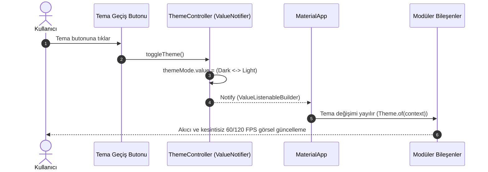

# Reaktif Durum ve Veri Akışı Referans Kılavuzu (State Flow Reference)

Bu doküman, **StartPath – Girişimcilik ve Mentor Eşleştirme Platformu** uygulamasında ve `startpath-feature-scaffold` yeteneğinde uygulanan reaktif durum mimarisinin (`ValueNotifier`), veri akışının, dinamik tema geçişinin ve modül yaşam döngüsünün teknik referans rehberidir.

Projedeki tüm modüller [project.md](file:///Users/d1-23/Documents/GitHub/hedasu/StartPath/project.md) ve [.agents/skills/SKILL.md](file:///Users/d1-23/Documents/GitHub/hedasu/StartPath/.agents/skills/SKILL.md) standartlarına tavizsiz uymak zorundadır.

---

## 1. Temel Mimari Prensipler ve Kırmızı Çizgiler

> [!IMPORTANT]
> **Kırmızı Çizgi 1 (Ağır `setState` Yasağı):** Sayfa düzeyinde büyük ağaçları baştan sona yeniden çizen `setState` kullanımı kesinlikle yasaktır. Sadece yerel geçici arayüz durumları (örneğin buton animasyonları, görsel geçiş efektleri) için `StatefulWidget` kabul edilir.

> [!WARNING]
> **Kırmızı Çizgi 2 (Harici Ağır Paket Yasağı):** Kullanıcıdan açık onay alınmadan projeye Bloc, Riverpod, MobX veya GetX gibi harici durum yönetim paketleri **eklenmeyecektir**. Dart ve Flutter'ın yerel çekirdek API'leri olan `ValueNotifier`, `ValueListenableBuilder` ve `ChangeNotifier` esastır.

> [!TIP]
> **UI ve Performans Standardı:**
> - Statik tüm widget tanımlarında `const` zorunludur.
> - Tek bir `build()` metodu asla 40 satırı geçemez. Aşan yapılar bağımsız özel widget bileşenlerine parçalanmalıdır.
> - Renkler ve tipografiler doğrudan kod içine gömülmez; tema (`AppTheme`) ve `AppColors` tanımları üzerinden çağrılır.

---

## 2. Reaktif Durum Akış Şeması (Unidirectional Data Flow)

Sistemdeki veri akışı **tek yönlüdür (Unidirectional Data Flow)**. Kullanıcı etkileşimi doğrudan kontrolcü metodunu tetikler; kontrolcü durumu atomik olarak günceller ve yalnızca ilgili `ValueListenableBuilder` düğümü yeniden çizilir.

```mermaid
graph TD
    subgraph UI_Layer["Arayüz Katmanı (View & Widgets)"]
        UI_Action["Kullanıcı Aksiyonu (Örn: Mentor Filtrele veya Başvur Butonu)"]
        VLB["ValueListenableBuilder<List<MentorProfileModel>>"]
        ReRender["Hedeflenen Parçacık Widget Render (<40 satır)"]
    end

    subgraph Controller_Layer["İş Mantığı Katmanı (Controller)"]
        CtrlMethod["controller.filterBySector(sector)"]
        StateUpdate["mentors.value = updatedList"]
        StatusUpdate["status.value = ApplicationStatus.submitted"]
    end

    subgraph Model_Layer["Veri Modeli (Immutable)"]
        NewModel["MentorProfileModel / ApplicationModel"]
    end

    UI_Action -->|1. Tetikler| CtrlMethod
    CtrlMethod -->|2. Yeni Model Üretir / Günceller| NewModel
    CtrlMethod -->|3. Değeri Günceller| StateUpdate
    StateUpdate -->|4. Bildirir (Notify)| VLB
    VLB -->|5. Scoped Render| ReRender
```

---

## 3. Dinamik Tema Akışı (Material 3 Modern Professional)

StartPath iki atmosferik temayı destekler:
- **Koyu Tema (Dark Mode):** Premium ve profesyonel atmosfer; koyu petrol yeşili, antrasit, derin orman yeşili ve şampanya altını vurgular.
- **Aydınlık Tema (Light Mode):** Modern, ferah ve güvenilir girişimcilik platformu; fildişi, krem, adaçayı yeşili, petrol yeşili ve zarif altın detaylar.



---

## 4. Bellek Yönetimi ve Yaşam Döngüsü (`dispose`)

> [!CAUTION]
> Kontrolcüler tarafından açılan her `ValueNotifier` nesnesi, ekran veya modül bellekten ayrılırken mutlaka `dispose()` edilmelidir. Aksi takdirde bellek sızıntısı (memory leak) oluşur.

```dart
class TeamMatchingController {
  final ValueNotifier<bool> isLoading = ValueNotifier<bool>(false);
  final ValueNotifier<List<TeamPostModel>> teamPosts = ValueNotifier<List<TeamPostModel>>([]);

  void dispose() {
    isLoading.dispose();
    teamPosts.dispose();
  }
}
```

---

## 5. Doğrulama ve Kalite Standartları

Herhangi bir durum akışı veya kodlama sonrasında aşağıdaki komutlar çalıştırılarak 0 uyarı ve 0 hata şartı doğrulanmalıdır:

```bash
# 1. Statik Kod Analizi (0 hata, 0 uyarı zorunludur)
flutter analyze

# 2. Birim ve Durum Testleri
flutter test

# 3. Canlı Uygulama Doğrulaması
flutter run
```
